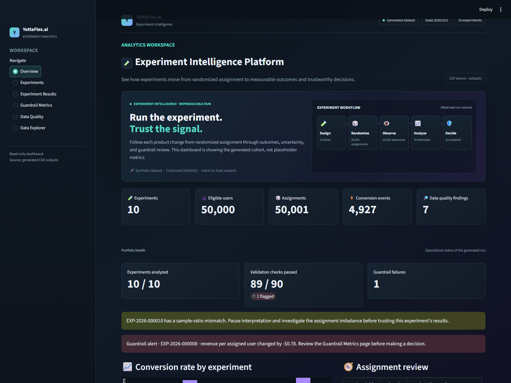

<p align="center">
	
</p>

# YottaFlex.ai Experiment Analytics Platform

**Live Demo:** [https://yottaflex-experiment-analytics-cxfwqjrazfjtmyzy8l9de4.streamlit.app/](https://yottaflex-experiment-analytics-cxfwqjrazfjtmyzy8l9de4.streamlit.app/)

A synthetic A/B-testing and analytics platform developed for YottaFlex's 72-hour project-build exercise. It runs 10 experiments over 50,000 eligible users, validates randomized assignments, estimates treatment effects, surfaces guardrail failures, and exports traceable data. A separate Streamlit dashboard makes the generated results easy to explore.

## Features

- Reproducible synthetic experiment and event data using seed `20261022`.
- Predeclared control/treatment variants and intent-to-treat analysis.
- Distinct conversion-rate V1/V2 formulas with an explicit, validated post-results metric-change event.
- Confidence intervals, p-values, guardrail decisions, and anomaly checks.
- SRM-affected estimates remain visible for diagnosis, but are marked invalid and must not guide decisions.
- Labeled edge cases with a separate numeric ground-truth file.
- CSV, JSON, SQLite, and SQL exports plus validation and source-manifest files.
- Six-page Streamlit dashboard that reads the generated outputs without changing the pipeline.

## Dashboard Screenshots

Captured from the live dashboard after the full-scale run (`seed=20261022`, 50,000 eligible users):



## Users of the platform

- Marketing and sales operations define the audience, hypothesis, variants, and launch window.
- Customers or prospects are represented only by synthetic audience IDs and simulated events.
- Support agents can inspect exposure and conversion history when investigating a reported issue.
- Analysts review randomization checks, guardrails, uncertainty, treatment effects, and anomaly labels.
- System administrators review lifecycle events, schema integrity, exports, and reproducibility records.

## Beginner-friendly project plan

1. Define the schema, data dictionary, lifecycle rules, and validation rules.
2. Set shared settings and a fixed seed (`20261022`), then generate master records before dependent records.
3. Generate 10 experiments and 50,000 eligible synthetic users, followed by deterministic variants, eligibility links, assignments, exposure events, and conversion events.
4. Simulate controlled treatment effects, noncompliance, missing telemetry, delayed conversions, guardrail regressions, and balanced/unbalanced assignments.
5. Inject the required negative scenarios as explicit labeled records, without silently damaging unrelated rows.
6. Validate ID formats, keys, foreign keys, enums, numeric bounds, dates, lifecycle transitions, assignment ratios, and arithmetic reconciliation.
7. Calculate the predeclared intent-to-treat (ITT) primary and guardrail metrics, treatment effects, confidence intervals, and p-values from source records.
8. Compare results with separate anomaly labels and numeric population expectations; surface sample-ratio mismatch and guardrail failures.
9. Export CSV, JSON, and SQLite seed data, plus a source manifest and validation summary.
10. Regenerate twice with the same seed and compare row counts and checksums; document the generator command and results.

## Project structure

```text
.
|-- main.py                 # Runs the full workflow
|-- app.py                  # Starts the separate Streamlit dashboard
|-- dashboard_data.py       # Loads CSV outputs and derives observed arm means
|-- config.py               # Shared settings, including the fixed seed
|-- data_generation.py      # Synthetic records, metric definitions, and change event
|-- assignment.py            # Randomized control/treatment assignment
|-- simulation.py           # Exposure and conversion outcomes
|-- validation.py           # Randomization and data-quality checks
|-- metrics.py              # Guardrail metrics and treatment effects
|-- anomalies.py            # Anomaly detection
|-- ground_truth.py         # Known expected outcomes for comparison
|-- export.py               # CSV, JSON, and SQLite exports
|-- .streamlit/
|   `-- config.toml         # Dark theme and Streamlit server settings
|-- docs/
|   `-- data_dictionary.md  # Fields, keys, relationships, and business rules
|-- data/                   # Generated input data, if saved separately
|-- outputs/                # Generated results and database
|-- tests/                  # Small checks of project behavior
|   |-- test_reproducibility.py
|   `-- test_dashboard_data.py
|-- requirements.txt        # Python-version-compatible pinned dependencies
`-- README.md               # Project overview and run instructions
```

Python's built-in `sqlite3` module will write the SQLite database, so SQLite does not need a separate pip package. The project will use pandas, NumPy, and SciPy for data handling, simulation, and statistical calculations.

## Build sequence

The schema and data dictionary define the contract. The generator, assignment, simulation, validation, analysis, anomaly and numeric ground-truth stages, append-only lifecycle events, exports, CLI, and tests are implemented as separate modules so each stage can be read and checked independently.

## Run it

Use Python 3.10 or newer. From the project folder, create an isolated environment and install the listed packages:

```powershell
py -m venv .venv
.\.venv\Scripts\python.exe -m pip install -r requirements.txt
```

In VS Code, choose **Python: Select Interpreter** from the Command Palette and select `.venv\Scripts\python.exe`. Open a new terminal after selecting it. The commands below call the virtual-environment interpreter directly, so they do not depend on the global `python` command being on PATH.

Generate a fast starter dataset (500 users per experiment):

```powershell
.\.venv\Scripts\python.exe main.py --scale 0.1 --seed 20261022
```

Generate the full dataset (5,000 users per experiment, 50,000 total):

```powershell
.\.venv\Scripts\python.exe main.py --scale 1.0 --seed 20261022
```

Regenerate twice and compare row counts and checksums:

```powershell
.\.venv\Scripts\python.exe main.py --scale 1.0 --seed 20261022 --verify-reproducibility
```

Run the focused tests:

```powershell
.\.venv\Scripts\python.exe -m unittest discover -s tests -v
```

## Run the dashboard

The dashboard is a separate app. It reads the generated CSV files in `outputs/`; it does not rerun or modify the analytics pipeline.

1. Select `.venv\Scripts\python.exe` using **Python: Select Interpreter** in VS Code.
2. In the VS Code terminal, install the dashboard dependency with the rest of the project packages:

```powershell
.\.venv\Scripts\python.exe -m pip install -r requirements.txt
```

3. If the generated CSV outputs are not present, create them first:

```powershell
.\.venv\Scripts\python.exe main.py --scale 1.0 --seed 20261022
```

4. Start Streamlit:

```powershell
.\.venv\Scripts\python.exe -m streamlit run app.py --server.address 0.0.0.0 --server.port 8501
```

5. On your laptop, open `http://localhost:8501`. To find the laptop's Wi-Fi IPv4 address, open another PowerShell terminal and run:

```powershell
ipconfig
```

Look under **Wireless LAN adapter Wi-Fi** for **IPv4 Address**, for example `192.168.1.25`. On your phone, connected to the same Wi-Fi network, open `http://192.168.1.25:8501`, replacing that example with your laptop's address. If Windows Firewall prompts you, allow Python on **Private networks** only. Do not configure router port forwarding or expose this development server to the public internet. Keep the Streamlit terminal running while you use the dashboard; press `Ctrl+C` there to stop it.

The sidebar contains Overview, Experiments, Experiment Results, Guardrail Metrics, Data Quality, and Data Explorer. The result view derives observed arm averages from assignment and in-window conversion CSVs, then displays them alongside the saved estimates and uncertainty. An SRM-failed experiment still shows its calculated estimates for diagnosis, but each result has `result_valid=false`, its decision is `invalid`, and the dashboard warns not to use it for decision-making. Experiments that pass assignment-integrity and SRM checks retain their normal valid results. The data explorer filters and downloads views of the generated CSVs.

The run writes one CSV and JSON file per table, including `metric_definition_change_events.csv`, separate `ground_truth.csv` and `ground_truth.json`, plus `experiment_analytics.sqlite`, `seed_data.sql`, `source_manifest.json`, `validation_summary.csv`, `validation_issues.csv`, `validation_checks.csv`, and `run_summary.json` under `outputs/`. The conversion-rate V001 formula counts all in-window converters; V002 counts only converters without an in-window refund. A first-class change event records both definition IDs, its UTC timestamp, and its reason after all V001 results are analyzed. Validation checks the event against effective dates and results, and ground truth records the event while preserving the original result references. The manifest records the seed, row counts, generation command, and CSV SHA-256 checksums. Validation issues remain visible in their own table; labeled edge cases are not silently removed.

## Deploy on Streamlit Community Cloud

The dashboard entry point is `app.py`. It reads CSV files from `outputs/`; the CSV exports are sufficient for deployment, including all 18 CSVs so the Data Explorer retains every generated table. JSON, SQLite, SQL, manifest, and run-summary exports are not needed by the dashboard and are excluded from GitHub by `.gitignore`. These files remain available locally and can be regenerated with `main.py` when needed.

1. Upload the project files and `outputs/*.csv`. Do not upload virtual environments, caches, `.env` files, Streamlit secrets, or the optional JSON/SQLite/SQL exports.
2. In Streamlit Community Cloud, choose **Create app**, select the repository and branch, and set the main file path to `app.py`.
3. Deploy. Streamlit installs the dependencies from `requirements.txt`; the app then reads the committed generated CSV files.

No credentials are required by this synthetic dashboard. Do not add secrets to the repository. The `0.0.0.0` setting is for local-network access; Community Cloud manages its own public serving configuration. The generated user IDs and data are synthetic.

## Synthetic data and provenance

All records are generated synthetically with seeded NumPy random generators. User IDs do not represent real people, and no external or personal data is collected. Public data is not needed for this project.

## Reading the code

- `dashboard_data.py` loads the generated CSV files and calculates the observed arm averages used by the dashboard.
- `app.py` displays those outputs as the six interactive interview-demo sections.
- `config.py` holds shared settings so the seed and scale are easy to find.
- `data_generation.py` creates experiments, variants, users, metric definitions, eligibility links, guardrails, and initial lifecycle events.
- `assignment.py` performs seeded assignment and adds the controlled duplicate-assignment and sample-ratio-mismatch cases.
- `simulation.py` produces exposure telemetry and conversions, including missing telemetry, noncompliance, delayed outcomes, and labeled timing cases.
- `validation.py` checks keys, relationships, dates, lifecycle, assignment ratios, and result reconciliation.
- `metrics.py` calculates assignment-based intent-to-treat effects and uncertainty.
- `anomalies.py` surfaces detected validation failures and guardrail regressions.
- `ground_truth.py` creates a separate evaluation file from the known rules and detected outcomes.
- `export.py` writes CSV, JSON, SQLite, SQL, and provenance artifacts.
- `main.py` connects the stages and offers the command-line options.
